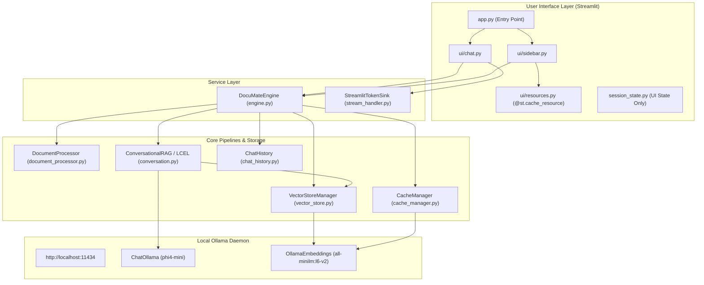

# DocuMate-AI

[](https://github.com/jr7122004j-dot/DocuMate-AI/actions/workflows/ci.yml)

[](LICENSE)


DocuMate-AI is an intelligent, on-device document analysis assistant built with Python, LangChain,
and Ollama. It enables private, scalable PDF question-answering with semantic caching, real-time
token streaming, and pinpoint source citations.

---

## Key Features

- **100% On-Device & Private:** Runs entirely locally via Ollama (`phi4-mini` and
  `all-minilm:l6-v2`). No API keys, third-party subscriptions, or cloud telemetry.
- **Multi-PDF Intelligence:** Ingests and indexes multiple PDF files with smart chunking, document
  fingerprinting, and empty/scanned document detection.
- **High-Performance Semantic Caching:** Dual-tier exact hash (SHA-256) and cosine similarity
  vector lookup, eliminating redundant LLM generation and returning sub-millisecond cached answers.
- **Pinpoint 1-Based Citations:** Structured citations showing source document filename,
  1-based page number, and context snippets inside a collapsible UI expander.
- **Deterministic Token Streaming:** UI-agnostic `TokenSink` streaming with throttled UI rendering
  and typing cursor (▌), preventing intermediate condense-question prompt leakage.
- **Compound Multi-Question Processing:** Decomposes complex queries (e.g. *"What is X? And how
  does Y work?"*) into sub-queries evaluated against an isolated history snapshot without memory
  pollution.
- **Ollama Health Diagnostics:** Real-time health monitoring in the sidebar displaying server
  availability and actionable CLI pull commands if models are missing.
- **Execution Diagnostics:** Collapsible debug panel displaying execution timing breakdowns
  (`cache_ms`, `retrieval_ms`, `generation_ms`, `total_ms`), similarity scores, and standalone query
  representations.

---

## Architecture Overview

DocuMate-AI is built on a clean service layer (`DocuMateEngine`) that completely decouples business
logic and RAG pipelines from Streamlit:



For detailed pipeline design and data flows, see the [Architecture Guide](docs/architecture.md).

---

## Prerequisites

1. **Python:** `>=3.10, <3.15` (Recommended: **Python 3.12** or **3.13**).
2. **Ollama:** Download and install [Ollama](https://ollama.ai/).
3. **Pull Models:**
   ```bash
   ollama pull phi4-mini
   ollama pull all-minilm:l6-v2
   ```

---

## Quick Start

### 1. Clone & Set Up Virtual Environment

```bash
git clone https://github.com/jr7122004j-dot/DocuMate-AI.git
cd DocuMate-AI

# Create virtual environment
python -m venv .venv

# Activate virtual environment
# Windows (cmd/PowerShell):
.venv\Scripts\activate
# macOS/Linux:
source .venv/bin/activate

# Install in editable mode with development dependencies
pip install -e ".[dev]"
```

### 2. Configure Environment (Optional)

Copy the example environment configuration:
```bash
cp .env.example .env
```

### 3. Launch the Application

```bash
streamlit run src/documate_ai/app.py
```

The application will open in your default browser at `http://localhost:8501`.

---

## Configuration Reference

DocuMate-AI supports typed configuration via environment variables (with `DOCUMATE_` prefix):

| Environment Variable | Default | Description |
| :--- | :--- | :--- |
| `DOCUMATE_LLM_MODEL_NAME` | `phi4-mini` | Ollama model name for language generation. |
| `DOCUMATE_EMBEDDING_MODEL_NAME` | `all-minilm:l6-v2` | Ollama model name for text embeddings. |
| `DOCUMATE_OLLAMA_BASE_URL` | `http://localhost:11434` | Base URL of the Ollama server. |
| `DOCUMATE_SIMILARITY_THRESHOLD` | `0.85` | Cosine similarity threshold for semantic cache hits. |
| `DOCUMATE_SIMILARITY_SLIDER_MIN`| `0.50` | Lower bound for cache threshold slider. |
| `DOCUMATE_SIMILARITY_SLIDER_MAX`| `0.99` | Upper bound for cache threshold slider. |
| `DOCUMATE_CHUNK_SIZE` | `1000` | Target chunk size in characters for document splitting. |
| `DOCUMATE_CHUNK_OVERLAP` | `200` | Overlap in characters between adjacent chunks. |
| `DOCUMATE_RETRIEVER_K` | `4` | Number of document chunks retrieved per query. |
| `DOCUMATE_DATA_DIR` | `./data` | Base directory for vector stores and cache storage. |
| `DOCUMATE_LOG_LEVEL` | `INFO` | Console logging level (`DEBUG`, `INFO`, `WARNING`, `ERROR`). |

---

## Development & Testing

### Running Tests Offline (No Ollama Required)
DocuMate-AI features a comprehensive suite of offline test doubles and fakes:

```bash
pytest -m "not ollama"
```

### Running Full Live-Model Tests
Requires Ollama running with `phi4-mini` and `all-minilm:l6-v2`:

```bash
pytest
```

### Static Type Checking
```bash
mypy src test
```

### Quality Assurance & Feature Parity
For the full QA audit and edge-case validation report, see [docs/QA.md](docs/QA.md).

---

## Project Structure

```text
DocuMate-AI/
├── .github/workflows/       # GitHub Actions CI matrix workflow
├── data/                    # Default persistent directory for cache & chroma (gitignored)
├── docs/                    # Architecture guide and QA reports
│   ├── architecture.md      # Detailed system architecture and module map
│   └── QA.md                # Feature-parity checklist vs legacy implementation
├── src/documate_ai/         # Main package source code
│   ├── ui/                  # Modular Streamlit components (sidebar, chat, resources)
│   ├── app.py               # Streamlit application entry point
│   ├── cache_manager.py     # Semantic cache with cosine similarity matching
│   ├── chat_history.py      # Conversation turn and history manager
│   ├── config.py            # Pydantic Settings and prompt templates
│   ├── conversation.py      # LCEL Conversational RAG pipeline
│   ├── document_processor.py# PDF loader, chunker, and validation
│   ├── engine.py            # Streamlit-free DocuMateEngine service layer
│   ├── errors.py            # Typed domain error hierarchy
│   ├── logging_config.py    # Logging configuration
│   ├── models.py            # Ollama factories and health check
│   ├── question_parser.py   # Multi-question query detector and splitter
│   ├── response_processor.py# Citation formatting and post-processing
│   ├── schemas.py           # Dataclass schemas (ChatResponse, Citation, IngestReport)
│   ├── stream_handler.py    # TokenSink protocol and StreamlitTokenSink
│   └── vector_store.py      # ChromaDB lifecycle and retriever factory
├── test/                    # Comprehensive test suite
│   ├── fixtures/            # Test PDFs and shared fixtures
│   ├── integration/         # Engine, vector store, and live Ollama tests
│   └── unit/                # Unit tests for all core modules and UI components
├── .env.example             # Template environment file
├── CHANGELOG.md             # Version history and release notes
├── pyproject.toml           # Modern package configuration with hatchling
└── README.md                # Project documentation and guide
```

---

## Roadmap

- [ ] **Phase 7 (Web Frontend):** FastAPI backend with Server-Sent Events (SSE) streaming and
  a lightweight, responsive vanilla HTML/CSS/JS web UI.
- [ ] **OCR Ingestion:** Tesseract / OCR integration for scanned, image-only PDF documents.
- [ ] **Hybrid Search:** Combine BM25 lexical search with dense vector embeddings and reranking.

---

## Credits & License

- Original proof-of-concept inspired by [PenSul/RAG-Chatbot](https://github.com/PenSul/RAG-Chatbot).
- Distributed under the [MIT License](LICENSE).
