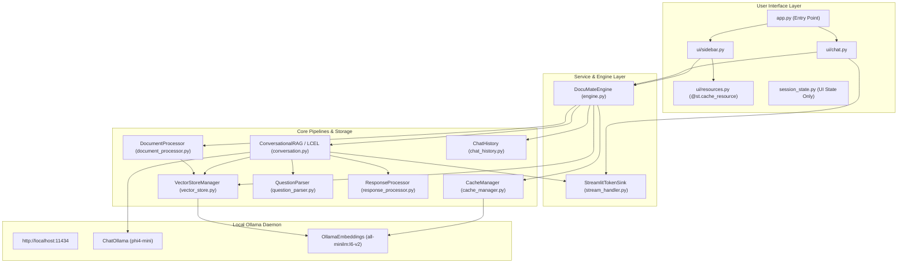

# DocuMate-AI Architecture Guide

This document describes the internal architecture, module responsibilities, and data flows of
DocuMate-AI.

---

## 1. High-Level Architecture Diagram

---

## 2. Core Architectural Principles

1. **Decoupled Engine (`DocuMateEngine`):**
   The core service layer has zero dependencies on `streamlit`. All operations (`ingest()`,
   `ask()`, `clear_history()`, `clear_cache()`, `reset()`) return typed Python dataclasses
   (`ChatResponse`, `Citation`, `IngestReport`) and raise typed exceptions (`DocuMateError`).
   This allows complete testability and enables future headless REST/web frontends.

2. **Deterministic Token Streaming (`TokenSink`):**
   Tokens are streamed directly from `conversation.stream_answer()` into any object implementing
   the `TokenSink` protocol. Condense-question prompt tokens are never sent to the sink,
   preventing intermediate rephrased query leakage into the UI.

3. **Isolated History Snapshots:**
   Multi-question queries and follow-up turns evaluate sub-questions against a single immutable
   history snapshot, appending exactly one combined turn to conversation memory to eliminate
   memory pollution.

4. **Semantic Caching Tier:**
   Queries first check an exact SHA-256 hash lookup in under 1ms. If missed, cosine similarity
   vector matching against cached query embeddings is evaluated against the configurable
   `similarity_threshold`. Cache hits return answer text and deduplicated citations instantly,
   bypassing LLM generation.

---

## 3. Module Responsibilities

| Module | Purpose |
| :--- | :--- |
| `config.py` | Pydantic-based `Settings` with `DOCUMATE_` environment overrides. |
| `errors.py` | Domain exception hierarchy (`DocuMateError`, `EngineNotReadyError`, etc.). |
| `models.py` | Ollama model factories and real-time health diagnostics. |
| `document_processor.py` | Multi-PDF extraction, empty page detection, and chunking. |
| `vector_store.py` | ChromaDB collection lifecycle and retriever creation. |
| `cache_manager.py` | Semantic cache index, SHA-256 fingerprinting, and cosine lookup. |
| `conversation.py` | LCEL conversational RAG chains, streaming, and multi-question. |
| `stream_handler.py` | `TokenSink` protocol, `StreamlitTokenSink`, and test fakes. |
| `engine.py` | Service layer coordinating ingestion, RAG, cache, and history. |
| `session_state.py` | Lightweight per-session Streamlit state manager. |
| `ui/sidebar.py` | Sidebar UI: document upload, progress tracking, cache settings. |
| `ui/chat.py` | Chat UI: history display, live token streaming, citations expander. |
| `app.py` | Streamlit entry point coordinating session state and component renders. |
